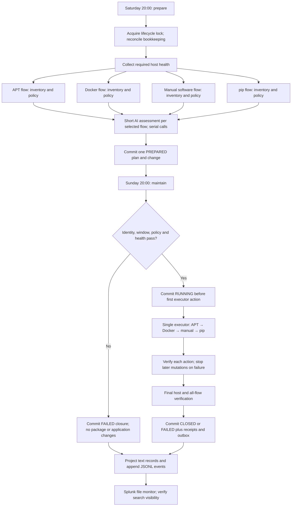

# Architecture and End-to-End Flow

## The complete cycle

On Saturday evening the controller inspects the host and runs four software flows. Each flow identifies its own eligible work and produces structured facts. Deterministic policy constructs candidate actions; a short AI assessment checks each nonempty proposal. The controller writes one immutable plan and one PREPARED change record containing all selected work and all deferred findings.

On Sunday evening the controller validates that same change, rechecks health and policy, and performs selected actions in sequence. Each action is verified before the next starts. A failure stops further changes. Final host verification and deterministic closure produce one CLOSED or FAILED record. Audit events reach Splunk through the existing file-monitoring integration.



The branches show ownership, not concurrent mutations. Collectors and AI calls are serial initially to limit load on the smaller host. Flows with no selected actions retain their findings and skip AI. See [the SVG drawing](flow.svg) for a browser-viewable version.

## Runtime boundaries

| Component | Owns | Permissions and constraints |
| --- | --- | --- |
| Scheduler | Two maintenance lifecycle triggers | Starts reviewed units; no policy or execution logic |
| Orchestrator | Lock, identities, state transitions, ordering, deadlines | Root oneshot initially; only authority to change lifecycle state |
| Four flow modules | Domain inventory, proposals, deterministic rules, verification | Return structured data; no independent scheduling or mutation |
| AI adapter | Small preparation assessments | No shell/tools; gateway credential only; bounded redacted input; cannot write state or execute actions |
| Plan builder | Approved action IDs and normalized parameters | Trusted code; never adopts model-supplied argv, URLs, paths, or versions |
| Executor | All package/application mutations | In-process deterministic module; exact catalogue handlers; one action at a time |
| Verifier | Expected-versus-actual checks | Read-only inspection; cannot repair, retry, or select final status from prose |
| State store/finalizer | Transactions, records, receipts, outbox | Called by orchestrator under lock; finalizer persists the orchestrator's deterministic decision |
| Event projector | JSONL delivery and projection receipts | Appends under a log lock; never repeats maintenance to reproduce an event |
| Splunk | Indexed views of emitted events | Existing monitor integration; not authoritative for execution state |

Bookkeeping writes to state/logs and bounded download scratch space are distinct from managed application mutation. Read-only collection means no package installation, service change, image pull into the live Docker daemon, or application-directory change. Scratch paths are private, quota checked, and never live installation paths.

The initial root process is retained for compatibility; this does not create an OS-enforced security boundary between Python modules. Before manual/pip activation, collector and AI children use systemd credential/sandbox mechanisms and a dedicated `ai-sysadmin-worker` account created only by the reviewed installer. Root-only reads use fixed collector helpers. Docker inspection is a trusted root helper because access to its socket is not a read-only privilege. No general shell endpoint or network execution service is introduced.

The final child profiles use `NoNewPrivileges=true`, `ProtectSystem=strict`, `PrivateTmp=true`, and explicit read-only binds for registered inspection paths. AI has only its credential and access to the registered gateway endpoint; collectors receive no gateway credential. Staging has write access only to the assigned scratch/release staging directory and uses the registered artifact origins. Application smoke checks run as the existing application user. Required path/network access is derived from registrations and verified by sandbox tests, never opened broadly to make a failing check pass.

The installer creates `/etc/ai-sysadmin-multi-agent/config.toml` and `IGNORE.md` from the reviewed effective policy, and provisions a separate root-owned `litellm.key` with mode 0600 through the existing credential source. No secret enters source control or a model prompt. Production state stays at the legacy paths; code/configuration and shadow paths use the new names. Changes to either installation's configuration are not implicitly mirrored into the other.

## Repository layout to implement

```text
ai-sysadmin-multi-agent/
  src/ai_sysadmin/
    cli.py                 # compatibility commands and explicit operator commands
    orchestrator.py        # lifecycle authority and ordered invocation
    contracts.py           # strict envelopes and version validation
    state.py               # SQLite transactions, projections and import
    policy.py              # global rules and policy fingerprints
    executor.py            # fixed command construction and action journal
    verification.py        # host-wide outcome and drift checks
    events.py              # redaction, outbox and JSONL projection
    ai.py                  # small LiteLLM requests
    flows/
      apt.py
      docker.py
      manual.py
      pip.py
  scripts/                 # installer and deterministic deployment renderer
  systemd/
  splunk/
  schemas/
  tests/                   # legacy fixtures, contracts, integration, failures
```

This tree specifies future code; this planning folder is not an installable implementation.

## Shared action and flow contracts

Each flow exposes `inspect`, `propose`, `validate`, and `verify`; only the executor exposes `apply`. Results contain flow name, schema version, host identity, mode, change/run/attempt IDs, evidence timestamps and hashes, findings, collection errors, and one of `READY`, `NO_CHANGE`, `NO_TARGET`, `DEFERRED`, or `BLOCKED`.

An action contains a catalogue ID, registered target ID, exact normalized arguments generated by code, expected state, verification requirements, and an estimated duration/disk requirement. At preparation, APT actions refer to the bounded transaction policy; their exact package set is supplied by the separately committed execution manifest after refresh. The other three flows pin exact artifacts in the plan.

Global blockers include missing required host evidence, invalid ignore policy, policy drift, low storage, failed health gates, an interrupted change, invalid handoff identity, and any required AI failure. A discovered unsupported product yields a visible deferred item. Errors collecting a registered target that may be changed are blockers, not an empty inventory.

All actions are serialized in APT, Docker, manual, pip order. Within each flow, use stable target-ID order. A registration dependency edge can require a prerequisite target to be healthy, but cannot change the global order; cycles or cross-flow order conflicts cause deferral and require a separate application change.

Before requesting AI approval, the plan builder admits only complete target action groups that fit the maintenance budget, in that same stable order. It reserves time for APT refresh/simulation and final verification, and lists overflow targets as deferred with a capacity reason. Runtime admission rechecks remaining time. It never selects more work than its budget and then labels unexecuted selected actions as successful. A target deferred for capacity in two consecutive windows is escalated for a separate scheduled application change; extending a routine window is not an AI decision.

## Ownership and shared verification

Every installed target has one maintenance owner. A dpkg-owned installation belongs to APT; a Docker image belongs to Docker; an explicitly registered venv belongs to pip; a registered vendor release belongs to manual. Discovery may cross-reference a target, but cannot create a second action for it. Conflicting ownership blocks that target's registration.

Before maintenance, capture host health and each registered target's state. After every action, check its exact expected result and readiness. At final verification, compare the complete before/after inventory against the union of expected changes across all four flows. This replaces the legacy verifier's blanket rejection of every non-APT change. Unexplained changes, failed selected actions, incomplete required evidence, or unhealthy host state produce FAILED. Deferred work remains clearly listed even when the selected change closes CLOSED.

## Tools and execution trust

Reuse the existing APT and Compose safety implementations behind their interfaces. Commands use absolute executable paths resolved and recorded during installation, argv arrays, a fixed environment, bounded output, and no shell interpreter. Models cannot add catalogue handlers. URLs, service names, file paths, and package identifiers come from reviewed configuration or validated repository metadata; they are not accepted from AI output.

Downloads require registered HTTPS origins, certificate validation, explicit size limits, and artifact verification. Redirects must remain within registered origins. A hash binds reviewed bytes; it is not proof of vendor authenticity by itself. The control plane and audit infrastructure are not targets of routine self-update.
